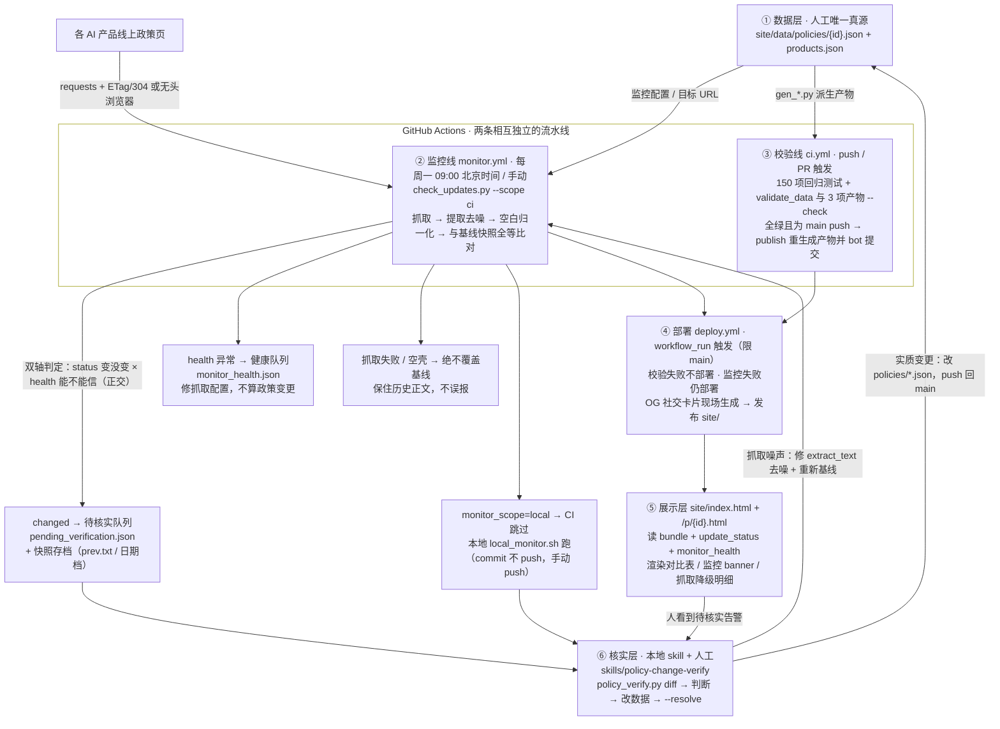

# 架构与端到端流程图

> **内部维护文档**，不随站点发布（对外文档在 `site/docs/`，由 `gen_docs.py` 渲染并消毒）。
> 本目录不经过任何渲染管道，可以用 Mermaid / HTML 自由表达。
> 浏览器打开同目录的 [`architecture.html`](architecture.html) 可看带样式的交互版流程图。

## 端到端流程（GitHub 原生渲染）

## 分层速览

| 层 | 载体 | 触发 | 详见 |
| --- | --- | --- | --- |
| ① 数据层 | `site/data/policies/{id}.json` | 人工 / 核实回写 | 对外版《数据流水线》 |
| ② 监控线 | `.github/workflows/monitor.yml` → `check_updates.py` | 每周一 09:00 北京 / 手动 | `site/docs/update-monitoring.md` |
| ③ 校验线 | `.github/workflows/ci.yml` | push / PR | 对外版《数据流水线》③ |
| ④ 部署 | `.github/workflows/deploy.yml` | workflow_run（两条线完成后） | 对外版《数据流水线》④ |
| ⑤ 展示层 | `site/index.html`、`site/p/{id}.html` | — | 对外版《数据流水线》⑤ |
| ⑥ 核实层 | `skills/policy-change-verify/` | 队列非空 / 人工发起 | 对外版《数据流水线》⑥ |

## 两个容易搞混的判定轴

- **status（变没变）**：`ok` / `changed` / `failed` / `suspicious` / `skipped` —— 只有 `changed` 进待核实队列；
- **health（能不能信）**：`ok` / `initialized` / `rebaselined` / `degraded` / `no_baseline` / `blocked` —— 非 `ok/initialized/rebaselined` 进健康队列，走修抓取配置的路线。

两轴**正交**：一次 Cloudflare 挑战只会进健康队列，不会污染"政策是否变化"的判断。抓取失败从不覆盖基线，也不会被当成待核实的政策变更。

## 与对外文档的关系

- `site/docs/*.md` 是**对外站点文档**的唯一源，经 `gen_docs.py` 渲染 + sanitize 白名单消毒后发布——所以那边只能用白名单内的标签（表格、代码块、ASCII 图）。
- 本目录是**内部文档**，无消毒、无发布，Mermaid 与 HTML 均可；改动不需要跑 `gen_docs.py`，但涉及对外文档或数据时仍需按 `AGENTS.md` 跑全量校验。
- ⚠️ 仓库 Settings → Pages 若切到 "Deploy from a branch" 并选 `/docs`，会把本目录公开——本项目用的是 Actions 部署 `site/`，**不要切换**。
